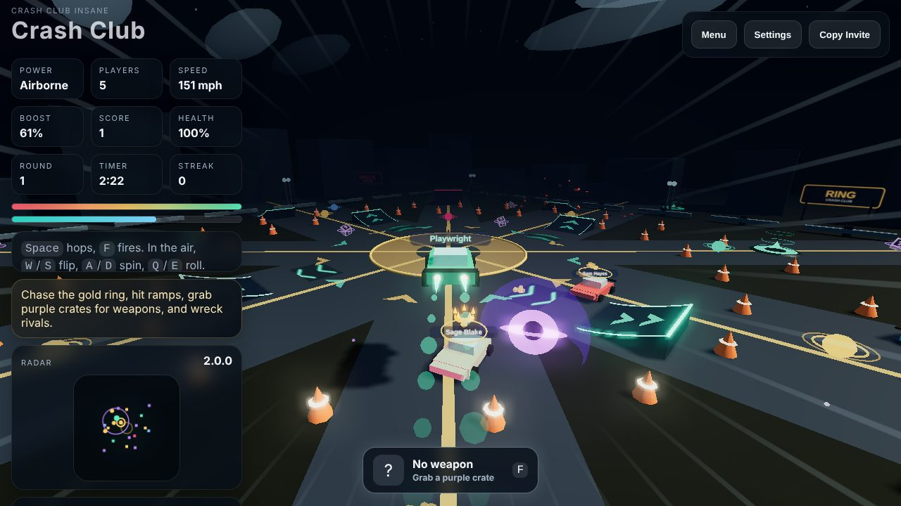
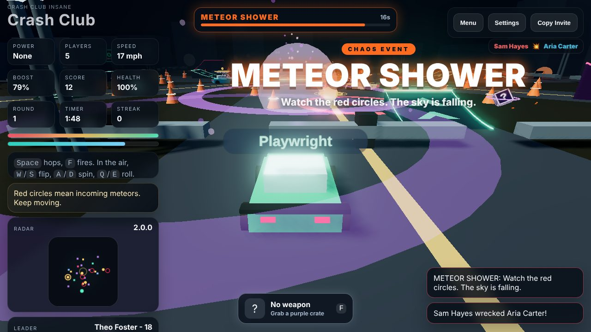
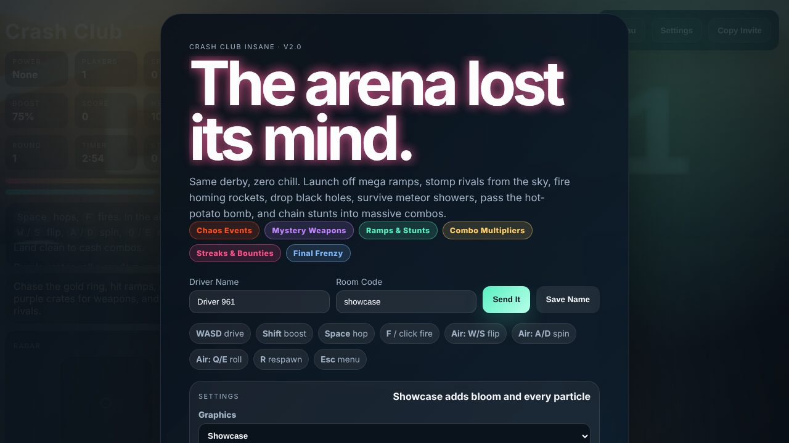

# Crash Club INSANE (v2.0)

<p align="center">
  
</p>

The original pitch: friends join the same room, slam into each other, steal boost pickups, and fight for the top score.
INSANE keeps every bit of that (rooms, bots, the gold ring, powerups, wrecks, the Gulag, podiums) and then removes the brakes.

## What's New

| Feature | What it does |
| --- | --- |
| Chaos events | Every ~30s the server rolls a mutator: **Meteor Shower**, **Moon Gravity**, **Black Ice**, **Hot Potato** (ram to pass a ticking bomb), **Ring Rush** (the ring roams the map at 3x points), **Nitro Frenzy**, **Bounty Hunt** (+25 for wrecking the leader), **Loot Storm**. |
| Final Frenzy | The last 30 seconds of every round: double points and meteors raining on everyone. |
| Ramps and pads | Kickers on every road, two **SEND IT** mega ramps, jump pads, and boost strips that chain into ramps. Ramp lips are solid walls. |
| Stunts | Hop with `Space`. In the air: `W`/`S` flip, `A`/`D` spin, `Q`/`E` barrel roll. Land on your wheels or wipe out. |
| Stomps | Fall onto a rival from above for **Death From Above** damage. |
| Mystery crates | Purple crates roll a weapon: **Homing Rockets**, **Prox Mines**, **Shockwave**, or a **Black Hole** that drags cars in and then pops. |
| Combos | Drifts, air, flips, spins, near misses, hits, and wrecks chain into a multiplier (up to x8) that cashes out as score. |
| Streaks and bounties | 3+ wrecks without dying sets you on fire and puts a bounty on your head. Multi-wrecks, First Blood, and Revenge all pay. |
| Juice | Bloom, explosions with debris, slow-mo on big hits, screen flashes, skid marks, speed lines, kill feed, announcer callouts (with optional voice), and a procedural soundtrack that ramps up with the chaos. |
| Bots | Bots grab crates, fire every weapon, hit ramps on purpose, pass the bomb, and chase the bounty. Their score counts at 0.35x (carried over from v1.5). |
| Redeploy | Losing the Gulag now means 20 seconds of spectating, not the rest of the round. |

<p align="center">
  
</p>

## Run It

```bash
cd insane
npm install
npm start
```

Open `http://localhost:3000` (add `?room=crew` to pick a room). Everyone on the same room code shares one arena.

## Controls

| Action | Keyboard | Touch |
| --- | --- | --- |
| Drive / brake | `W` `S` or arrows | `Gas` `Brake` |
| Steer | `A` `D` or arrows | `Left` `Right` |
| Boost (works in the air too) | `Shift` | `Boost` |
| Hop | `Space` | `Hop` |
| Fire weapon | `F` or left click | `Fire` |
| Front / back flip (air) | `W` / `S` (fresh press after takeoff) | - |
| Spin (air) | `A` / `D` | - |
| Barrel roll (air) | `Q` / `E` | - |
| Respawn / menu | `R` / `Esc` | `Reset` / `Menu` |

The Gulag is unchanged: `WASD` to move, mouse to aim, click, `Space`, or `F` to shoot.

## Server Knobs

All optional environment variables:

| Variable | Default | Purpose |
| --- | --- | --- |
| `PORT` | `3000` | HTTP and WebSocket port |
| `CRASH_CLUB_BOT_TARGET` | `6` | Bots per room while a human is connected |
| `CRASH_CLUB_TICK_RATE` / `CRASH_CLUB_SNAPSHOT_RATE` | `24` / `15` | Simulation and network rates |
| `CRASH_CLUB_ROUND_MS` | `180000` | Round length |
| `CRASH_CLUB_FIRST_EVENT_MS` | `20000` | Delay before the first chaos event |
| `CRASH_CLUB_FORCE_EVENT` | - | Always roll this event (`meteors`, `lowgrav`, `ice`, `bomb`, `ringrush`, `nitro`, `bounty`, `lootstorm`) |
| `CRASH_CLUB_FORCE_WEAPON` | - | Crates always roll this weapon (`rocket`, `mine`, `shockwave`, `blackhole`) |
| `CRASH_CLUB_README_SAFE_ARENA` | - | `1` makes humans immune to damage (for captures) |

## Deploying

INSANE uses a newer protocol than the live v1.5 backend, so its frontend and backend have to be deployed together:

- **Backend:** any long-lived Node host (Render works). Set the service root to `insane/` and use `npm start`.
- **Frontend:** Vercel with the project root set to `insane/` (it uses `vercel.json` and `npm run build:vercel`). Set `CRASH_CLUB_SERVER_URL` to the INSANE backend. There is deliberately no default, so a build can never point at the v1.5 server by accident.

The repository root (`render.yaml`, `backend/index.js`) still deploys the existing v1.5 backend and is untouched by this folder.

## Layout

| Path | What it is |
| --- | --- |
| `server.js` | Rooms, bots, scoring, chaos events, weapons and projectiles, explosions, Gulag, podium |
| `public/shared/arena.js` | Arena layout shared by client and server: walls, buildings, ramps, pads, ring path |
| `public/app.js` | Three.js client: driving and air physics, effects, HUD, audio, networking |
| `public/vendor/jsm/` | Three.js r164 post-processing addons used for bloom |

<p align="center">
  
</p>

## License

Same terms as the rest of this repository: Copyright (c) 2026 flowzygames, all rights reserved. See the root README.
